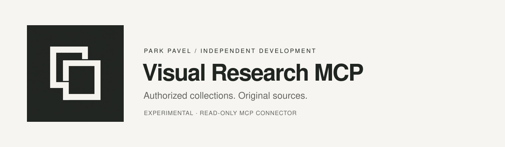
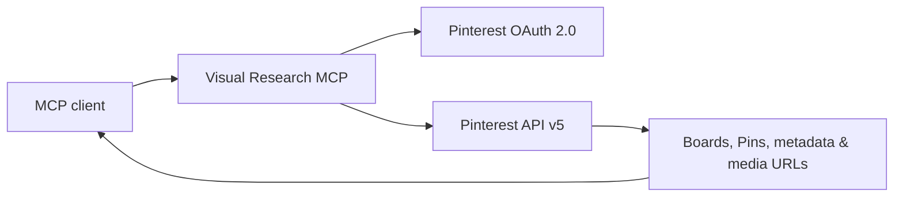

<div align="center">




# Visual Research MCP

**An independent, read-only Pinterest connector for MCP clients and visual research workflows.**

Access your authorized Pinterest boards, pins, collections and source media metadata from an AI assistant — with traceable links to the original Pins.

[](https://github.com/ParkPavel/Pinterest-research-mcp/issues)
[](https://developers.pinterest.com/docs/api/v5/)
[](https://modelcontextprotocol.io/)
[](https://web.tribute.tg/d/SwM)

[Getting started](#getting-started) · [Available tools](#available-tools) · [ChatGPT App preview](#chatgpt-app-preview) · [Privacy policy](PRIVACY.md) · [Support](#support-the-project)

</div>

---

## The idea

Visual research should be grounded in **actual source material**, not invented descriptions. Visual Research MCP aims to connect your own authorized Pinterest content to compatible AI tools, preserving each item's source link so you can investigate references, build moodboards and eventually derive evidence-backed brand-design patterns.

**Project status:** early-stage implementation, not a hosted service or verified ChatGPT installation. The default `main` branch contains a local `stdio` MVP; the HTTP + gallery + external OAuth validation work is in [the open draft PR #1](https://github.com/ParkPavel/Pinterest-research-mcp/pull/1). Pinterest developer API approval and real-account tests are still pending.

### What it can do

| Function | Current local MVP |
| --- | --- |
| Authorize a Pinterest account with OAuth 2.0 | Implemented in source; live flow not yet verified |
| Read accessible boards and board sections | Implemented in source |
| Read accessible Pins and their media URLs | Implemented in source |
| Paginate larger collections via `bookmark` | Implemented in source |
| Preserve Pin links for source attribution | Implemented in source |
| Analyze image pixels with a vision model | **Not implemented** |
| Hosted ChatGPT App with account-by-account OAuth | **Not deployed** |

## How it works



The connector requests read-only data available under the **authorized account's permissions**. Pinterest login does **not** grant unrestricted access to all Pinterest content, private accounts, recommendation feeds or arbitrary users' Pins.

## Getting started

**Prerequisites:** Node.js 20+, npm, Pinterest Developer App credentials and appropriate API access. Some Pinterest developer accounts require app review before access is granted.

```bash
git clone https://github.com/ParkPavel/Pinterest-research-mcp.git
cd Pinterest-research-mcp
npm install
cp .env.example .env
openssl rand -hex 32
```

Add `PINTEREST_APP_ID`, `PINTEREST_APP_SECRET`, and `TOKEN_ENCRYPTION_KEY` to **your local** `.env`. Register the matching `PINTEREST_REDIRECT_URI` in the Pinterest Developer App; some redirect URI formats may not be accepted by Pinterest. Never publish credentials or the encrypted token file.

```bash
npm run auth
npm run check
npm run build
npm start
```

`npm start` exposes the connector through local `stdio` to an MCP-compatible client. For initial debugging, use [MCP Inspector](https://modelcontextprotocol.io/docs/tools/inspector).

**Important:** Running `npm run auth` successfully requires Pinterest to approve the app, the requested API permissions, and the configured callback. Do not treat the project as tested against a real account yet.

## Available tools

| Tool | Returns |
| --- | --- |
| `pinterest_account` | Authorized Pinterest user information |
| `pinterest_boards` | Boards with pagination |
| `pinterest_board` | A board's metadata |
| `pinterest_board_pins` | Pins on a board, with source/media metadata |
| `pinterest_pins` | Accessible Pins, with pagination |
| `pinterest_pin` | A single Pin with a source URL |
| `pinterest_board_sections` | Sections of a board |
| `pinterest_section_pins` | Pins in a section |

## ChatGPT App preview

The proposed ChatGPT integration uses a **Streamable HTTP MCP endpoint**, an embedded pin-gallery UI, and an OAuth authorization layer. Development is tracked in [PR #1](https://github.com/ParkPavel/Pinterest-research-mcp/pull/1), with technical notes in [docs/CHATGPT_APP.md](https://github.com/ParkPavel/Pinterest-research-mcp/blob/feat/chatgpt-mcp-app-v0.2/docs/CHATGPT_APP.md).

It is **not installable in ChatGPT yet**: a secure public HTTPS deployment, end-user OAuth identity isolation and live end-to-end authorization checks remain required. The current prototype is for one connected developer account, not multiple users.

## Security and privacy

- Read-only integration by design; no publishing, pin editing or automated engagement.
- OAuth tokens are stored in a locally encrypted file in the MVP; secret keys remain outside Git.
- Do **not** commit `.env`, `.data/`, credentials, Pinterest session cookies or private user data.
- The project does not bypass platform privacy, rate limits or access controls.
- Personal content shared with an external AI service is subject to that service's separate privacy terms.

See [Privacy Policy](PRIVACY.md), [Security Policy](SECURITY.md) and [Contributing Guide](CONTRIBUTING.md).

## Roadmap

- [x] Local read-only Pinterest MCP tool registry
- [x] Pinterest API v5 & OAuth implementation in source
- [x] Encrypted local token store
- [ ] Complete Pinterest developer approval and real-account verification
- [ ] Complete and review [HTTP + UI prototype](https://github.com/ParkPavel/Pinterest-research-mcp/pull/1)
- [ ] Per-user secure OAuth and production HTTPS deployment
- [ ] Source-grounded, multimodal board analysis and visual search
- [ ] Test installation as a ChatGPT App

Progress and bug reports: [GitHub Issues](https://github.com/ParkPavel/Pinterest-research-mcp/issues).

## Support the project

Independent development takes time: API integrations, visual analysis, documentation and security reviews. If you find the direction useful, you can support the work on Tribute.

<div align="center">

### [♥ Support Visual Research MCP on Tribute](https://web.tribute.tg/d/SwM)

[](https://web.tribute.tg/d/SwM)

</div>

Support is optional and does not grant additional access to Pinterest data or API permissions.

## Visual identity

The independent project mark is used across the website, README, browser icons and sharing previews. [Download the application icon](docs/assets/icon-512.png) or see [all brand assets and verified requirements](docs/BRAND.md).

## Project information

**Maintainer:** [Park Pavel](https://github.com/ParkPavel)  
**Project repository:** [ParkPavel/Pinterest-research-mcp](https://github.com/ParkPavel/Pinterest-research-mcp)  
**Privacy:** [PRIVACY.md](PRIVACY.md)  
**Terms of external services:** Pinterest API and the connected AI client's own terms apply.

This is an **independent project** and is not affiliated with, sponsored by or endorsed by Pinterest. The repository is publicly viewable; redistribution and contributions require an explicit software license, which has **not yet been chosen**.
