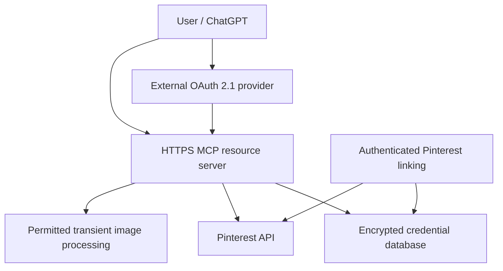

# Architecture and threat model

Current source in this branch: local stdio → fixed read-only Pinterest API client → encrypted local token store. No hosted HTTP or vision service is active. The adapters support explicit subjects for tests and future wiring; they do not authenticate users themselves.

Target topology (design, not deployed):

GitHub Pages is an independent static documentation host. It has no backend credentials and cannot host the MCP process. Staging and production require separate OAuth clients, encryption keys, databases, public endpoints and deployment identities.

| Asset / threat | Current mitigation | Remaining production requirement |
| --- | --- | --- |
| OAuth secrets in errors/logs | Fixed error codes, generic unknown errors | Reverse-proxy query/header scrubbing; log tests across infrastructure |
| Callback replay / CSRF | Exact callback and single-use expiring state in local process | Browser-session binding, transactional state across replicas |
| Tenant confusion | Explicit-subject APIs; ciphertext AAD; no missing-user fallback | Verified identity middleware, tenant DB constraints, adversarial HTTP tests |
| Refresh race / logout resurrection | Per-identity in-process lock and atomic file replacement | Distributed lock/CAS; invalidation and deletion generations |
| SSRF / credential forwarding | Fixed API origin/path allowlist and redirects disabled | Images fetched only from approved Pinterest media hosts, no redirects/private IPs, size/type limits; egress policy |
| Untrusted Pin content | Server instructions identify metadata as untrusted | UI uses text nodes and safe URLs; no HTML interpolation; prompt-injection analysis tests |
| Resource exhaustion | API timeout and 2 MiB JSON limit | HTTP body/connection/rate/concurrency caps and graceful drain |
| Persistence / third-party AI | No application Pin database; no vision endpoint | Pinterest permission, user notice, deletion/retention controls before activation |

A gallery that displays an image is separate from a model receiving image pixels. Future analysis must select a bounded sample, verify its source and access, deliver actual supported image content to the vision model, and record coverage/source IDs without retaining content beyond permitted processing. If image input fails, return an explicit unavailable state rather than infer visual properties from titles. Never download arbitrary `pin.link` targets.
